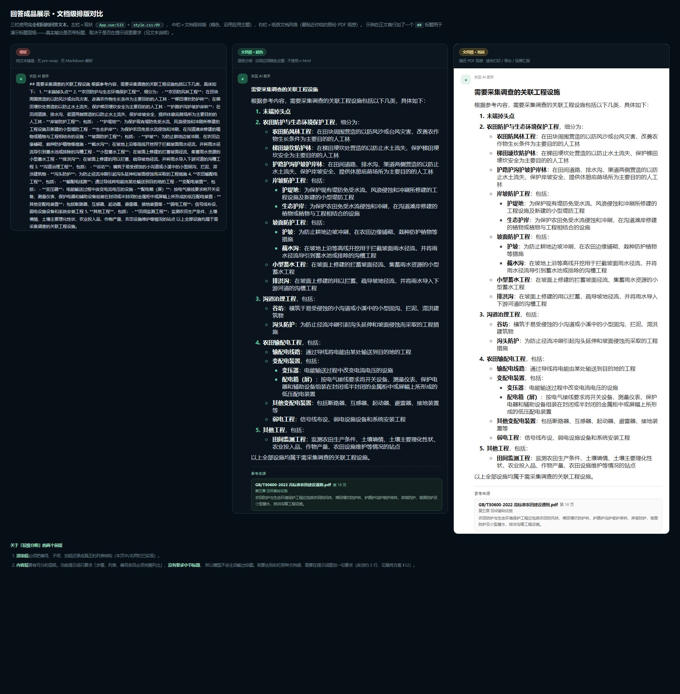

# 农田 AI 助手 · 回答渲染最终方案

> **本文件为最终方案**，可直接照着落地。
> 成品展示对比（文档级）：
> · [渲染方案-文档级预览.html](./渲染方案-文档级预览.html)（可交互）
> · [渲染方案-文档级对比.png](./渲染方案-文档级对比.png)
> · [渲染方案预览.html](./渲染方案预览.html)（首版：现状 vs 基础建议）
> 诊断证据底稿（字节码级验证、字段丢弃链路）：[农田AI助手-回答渲染优化方案.md](./农田AI助手-回答渲染优化方案.md)

---

## 0. 目标效果

目标是**成品展示像一份文档/PDF：层级分明、结论清晰**，而不只是「聊天里排版好一点」。对标你给的《Windows 连接步骤》。



三栏使用完全相同的回答文本：

| 方案 | 定位 | 落地方式 |
|---|---|---|
| 现状 | — | `App.vue:533` + `style.css:99` |
| **文档级 · 暗色（推荐默认）** | 沿用应用暗色主题，层级间距加大 | §5.4 的 `.md-*` 规则 |
| 文档级 · 纸质 | 接近 PDF 观感，适合打印 / 导出 / 投屏汇报 | §5.7 的主题覆盖块 |

> **关键认知**：要做出「文档感」，需要**两个前提同时成立**——
> ① **渲染层**把编号、子项、加粗还原成真正的列表结构（§5 已实现，含 3 级嵌套）；
> ② **内容层**要有可分的层级。当前提示词只要求「步骤、列表、编号条目必须完整列出」，**没有要求小节标题**，
> 所以模型只会输出列表、不会输出章节——文档感会差一半。补齐办法见 **§12**（改动约 4 行）。

排版规格对照：

| 参考图中的特征 | 落地规格（暗色文档级） |
|---|---|
| 加粗小节标题，独立成行、上下留白明显 | `.md-heading`：`15px / 700`，`margin:20px 0 10px` |
| 有序列表数字 + **悬挂缩进**（换行文字与首行文字对齐，不对齐到数字） | `.md-list{padding-left:2em}` + `list-style-position:outside` |
| 二级项目符号缩进、圆点更小 | 嵌套 `ul` 依次用 `circle` / `square` |
| **每个顶层条目之间有明显空隙** | `.md-list>li{margin:10px 0}`，子项 `5px` |
| 行内加粗 | `**…**` → `.md-bold`（提亮到 `#f2fbf7`，字重 700） |
| 舒适行高 | `line-height:1.9` |

实现后，你截图里那一坨会变成：1 个章节标题 + 5 个编号大类，每个大类下缩进的子项，子项下再缩进一层（如「岸坡防护工程 → 护堤地」「变配电装置 → 变压器」），末尾总结句独立成段。

---

## 1. 结论（三句话）

1. **渲染问题 100% 在前端**；后端**可选地**改 4 行提示词。后端已正确输出换行、`**` 与来源数据（`StreamingRagService` + `RagPromptTemplate`），渲染层完全不需要后端配合；但若要做出文档级的层级感，建议按 **§12** 追加 2 条规则要求模型输出小节标题。
2. **前端新增「解析器 + 结构化渲染组件」。** 共 3 个新文件、改 3 个已有文件，约 200 行。
3. **不引入任何第三方依赖，不使用 `v-html`。** 该工程只有 3 个运行时依赖（`vue`/`vue-router`/`@lucide/vue`）且带本地 `.npm-cache`，基调是极简；更关键的是 RAG 正文包含**从上传 PDF 检索出的不可信原文**，`v-html` 是最典型的 XSS 入口，节点树渲染从根本上免疫。

---

## 2. 根因（结论速览）

| 现象 | 根因 | 位置 |
|---|---|---|
| `**` 星号裸露 | 纯文本插值 `{{ message.text }}`，全工程无 Markdown 依赖 | `App.vue:533`、`package.json` |
| 结构塌成一坨 | `<p>` 缺 `white-space`，`\n` 被 HTML 空白折叠 | `style.css:99` |
| 换行**没有**丢在传输层 | Spring `SseEmitter` 对 String data 把 `\n` 替换为 `\ndata:` | 已用 `javap` 验证 `spring-webmvc-6.2.3`，见底稿 §2.5 |
| 引用不可点、无摘要 | 来源被降维成字符串，且 TS 类型少声明 3 个字段 | `App.vue:92-96`、`api/rag.ts:34-39` |

**重要澄清**：`RagPromptTemplate` 的【回答规则】7 条里**没有任何一处要求 Markdown**，唯一被规定的是引用格式 `（来源：[参考N]）`。所以 `**` 是模型的自发行为——这意味着解析器必须能容忍模型不输出 Markdown 的情况（降级为纯文本即可，见 §4.4）。

---

## 3. 改动清单

| 文件 | 性质 | 说明 |
|---|---|---|
| `front/src/utils/markdown.ts` | **新增** | Markdown → 节点树解析器（约 115 行） |
| `front/src/components/MessageBody.vue` | **新增** | 结构化渲染，自引用实现无限层级嵌套 |
| `front/src/components/SourceCards.vue` | **新增** | 引用来源卡片 |
| `front/src/style.css` | 追加约 22 行 | 排版规则 |
| `front/src/api/rag.ts` | 修改 3 行 | `Source` 补 `chunkId` / `sectionTitle` |
| `front/src/App.vue` | 修改 6 处 | 接入组件、sources 独立字段、流式标记 |
| 后端 `F:\ai\agent\rag` | **不改**（渲染层无需配合） | 仅「文档级层级感」需要可选的提示词改动，见 §12 |

---

## 4. 解析器规格

### 4.1 支持的语法（只覆盖模型实际会输出的）

| 输入 | 识别为 |
|---|---|
| `# ~ ####` 开头的行 | 标题（`level` 1–4） |
| `1.` `2.` `1、` `2)` 开头的行 | 有序列表项 |
| `-` `*` `+` `•` 开头的行 | 无序列表项 |
| `>` 开头的行 | 引用块 |
| 空行 | 段落 / 列表分界 |
| 其他非空行 | 段落 |

行内只解析三种：`**加粗**`、`*斜体*`、`` `代码` ``。**不解析表格、链接、图片、HTML**——这些在农田标准的问答里基本不出现，且解析 HTML 会引入安全面。

### 4.2 嵌套判定（核心）

按优先级三条规则：

1. **缩进优先**：行首空格数决定层级（制表符与全角空格视为 2 空格）。子项比父项缩进更深即成为其 `children`。
2. **标记类型变化兜底**：模型经常**不给子项缩进**就换标记类型（`1.` 下面直接写 `-`）。此时「同缩进 + 标记类型变化」视为进入下一层；若祖先中存在「同缩进 + 同类型」的层，则回退到那一层（这样 `1. → - → - → 2.` 能正确收尾）。
3. **顶格段落结束列表**：行首**无缩进**的普通文本行意味着此前的列表已结束（例如回答末尾的总结句）。这是对 CommonMark「懒惰续行」的**有意偏离**——实测中若不这样处理，末尾总结句会被错误地吞进最后一个 `<li>` 里（此 bug 已在原型中复现并修复，见 §8）。

### 4.3 行内解析

用正则 `/(\*\*[^*]+\*\*|`[^`]+`|\*[^*\n]+\*)/g` 切分，产出 `Inline[]`。**不生成 HTML 字符串**，交给渲染层用 `{{ }}` 输出，由 Vue 负责转义。

### 4.4 降级策略（必须）

- 语法不认识的行 → 原样作为段落输出，**绝不丢字**。
- 流式期间**完全不做** Markdown 解析（见 §6）。
- 未闭合的 `**` 正则匹配不上 → 保持字面显示，不会吃掉后文。

---

## 5. 完整代码

### 5.1 新增 `front/src/utils/markdown.ts`

```ts
/**
 * 极简 Markdown → 节点树解析器。
 * 只覆盖模型实际会输出的语法：标题 / 有序列表 / 无序列表 / 嵌套 / 段落 / 引用 / 行内加粗与代码。
 * 解析不了的内容一律降级为普通段落，绝不丢字。
 */

export type Inline = {
  text: string
  bold?: boolean
  italic?: boolean
  code?: boolean
}

export type MdListItem = {
  inline: Inline[]
  children: MdNode[]
}

export type MdNode =
  | { type: 'heading'; level: number; inline: Inline[] }
  | { type: 'paragraph'; inline: Inline[] }
  | { type: 'quote'; inline: Inline[] }
  | { type: 'list'; ordered: boolean; items: MdListItem[] }

type ListFrame = {
  indent: number
  ordered: boolean
  list: Extract<MdNode, { type: 'list' }>
}

const INLINE_RE = /(\*\*[^*]+\*\*|`[^`]+`|\*[^*\n]+\*)/g
const HEADING_RE = /^(#{1,4})\s+(.*)$/
const QUOTE_RE = /^\s*>\s?(.*)$/
const ITEM_RE = /^([ \u3000]*)(\d{1,2}[.、)]|[-*+•])\s+(.*)$/

export function parseInline(text: string): Inline[] {
  const out: Inline[] = []
  let cursor = 0
  for (const match of text.matchAll(INLINE_RE)) {
    const start = match.index ?? 0
    if (start > cursor) out.push({ text: text.slice(cursor, start) })
    const token = match[0]
    if (token.startsWith('**')) out.push({ text: token.slice(2, -2), bold: true })
    else if (token.startsWith('`')) out.push({ text: token.slice(1, -1), code: true })
    else out.push({ text: token.slice(1, -1), italic: true })
    cursor = start + token.length
  }
  if (cursor < text.length) out.push({ text: text.slice(cursor) })
  return out.length ? out : [{ text }]
}

export function parseMarkdown(source: string): MdNode[] {
  const lines = source.replace(/\r\n?/g, '\n').replace(/\t/g, '  ').split('\n')
  const blocks: MdNode[] = []
  const stack: ListFrame[] = []
  let paragraph: string[] = []

  // 段落归属：列表打开时挂到最内层最后一个列表项的 children，否则挂到顶层
  const container = (): MdNode[] => {
    const frame = stack[stack.length - 1]
    if (!frame) return blocks
    const item = frame.list.items[frame.list.items.length - 1]
    return item ? item.children : blocks
  }

  const flushParagraph = () => {
    if (!paragraph.length) return
    const text = paragraph.join(' ').replace(/\s+/g, ' ').trim()
    paragraph = []
    if (text) container().push({ type: 'paragraph', inline: parseInline(text) })
  }

  for (const rawLine of lines) {
    const line = rawLine.replace(/\s+$/, '')
    if (!line.trim()) {
      flushParagraph()
      continue
    }

    const heading = HEADING_RE.exec(line)
    if (heading) {
      flushParagraph()
      stack.length = 0
      blocks.push({ type: 'heading', level: heading[1].length, inline: parseInline(heading[2].trim()) })
      continue
    }

    const quote = QUOTE_RE.exec(line)
    if (quote) {
      flushParagraph()
      container().push({ type: 'quote', inline: parseInline(quote[1].trim()) })
      continue
    }

    const item = ITEM_RE.exec(line)
    if (item) {
      flushParagraph()
      const indent = item[1].replace(/\u3000/g, '  ').length
      const ordered = /^\d/.test(item[2])
      const inline = parseInline(item[3].trim())

      // 1) 收缩到不深于当前缩进的层级
      while (stack.length && stack[stack.length - 1].indent > indent) stack.pop()

      // 2) 同缩进但标记类型变了：模型常不给子项缩进，此时回退到同缩进同类型的祖先层
      if (stack.length) {
        const top = stack[stack.length - 1]
        if (top.indent === indent && top.ordered !== ordered) {
          const back = [...stack].reverse().find(f => f.indent === indent && f.ordered === ordered)
          if (back) while (stack.length && stack[stack.length - 1] !== back) stack.pop()
        }
      }

      // 3) 与栈顶同级同类 → 追加兄弟项
      const top = stack[stack.length - 1]
      if (top && top.indent === indent && top.ordered === ordered) {
        top.list.items.push({ inline, children: [] })
        continue
      }

      // 4) 否则新开一层列表
      const list: Extract<MdNode, { type: 'list' }> = {
        type: 'list', ordered, items: [{ inline, children: [] }],
      }
      container().push(list)
      stack.push({ indent, ordered, list })
      continue
    }

    // 顶格的普通文本行意味着此前的列表已经结束（如回答末尾的总结句）。
    // 若该行有缩进，则视为上一列表项的续行段落，保留在列表内。
    if (!paragraph.length) {
      const lead = line.length - line.trimStart().length
      if (lead === 0) stack.length = 0
    }
    paragraph.push(line.trim())
  }

  flushParagraph()
  return blocks
}
```

### 5.2 新增 `front/src/components/MessageBody.vue`

```vue
<script setup lang="ts">
import { computed } from 'vue'
import { parseMarkdown, type Inline, type MdNode } from '../utils/markdown'

// 自引用需要组件名（模板里的 <MessageBody> 解析依赖它）
defineOptions({ name: 'MessageBody' })

const props = defineProps<{
  text?: string
  nodes?: MdNode[]
  streaming?: boolean
}>()

// 流式中不解析 Markdown：半截语法会闪跳，长回答还会卡顿。
// 收到 done 后 streaming 置 false，一次性切换为结构化渲染（同一段文字，渐进增强）。
const tree = computed<MdNode[]>(() => {
  if (props.nodes) return props.nodes
  if (props.streaming) return []
  return parseMarkdown(props.text ?? '')
})

const segClass = (seg: Inline) => ({
  'md-bold': seg.bold,
  'md-italic': seg.italic,
  'md-code': seg.code,
})
</script>

<template>
  <!-- 流式阶段：保留真实换行，不做解析 -->
  <p v-if="streaming" class="md-plain">{{ text }}</p>

  <!-- 结构化阶段：全程不碰 v-html，文本仍由 Vue 自动转义 -->
  <div v-else class="md-body">
    <template v-for="(node, i) in tree" :key="i">
      <h3 v-if="node.type === 'heading'" class="md-heading" :class="`md-h${node.level}`">
        <span v-for="(seg, j) in node.inline" :key="j" :class="segClass(seg)">{{ seg.text }}</span>
      </h3>

      <blockquote v-else-if="node.type === 'quote'" class="md-quote">
        <span v-for="(seg, j) in node.inline" :key="j" :class="segClass(seg)">{{ seg.text }}</span>
      </blockquote>

      <ol v-else-if="node.type === 'list' && node.ordered" class="md-list">
        <li v-for="(item, k) in node.items" :key="k">
          <span v-for="(seg, j) in item.inline" :key="j" :class="segClass(seg)">{{ seg.text }}</span>
          <MessageBody v-if="item.children.length" :nodes="item.children" />
        </li>
      </ol>

      <ul v-else-if="node.type === 'list'" class="md-list">
        <li v-for="(item, k) in node.items" :key="k">
          <span v-for="(seg, j) in item.inline" :key="j" :class="segClass(seg)">{{ seg.text }}</span>
          <MessageBody v-if="item.children.length" :nodes="item.children" />
        </li>
      </ul>

      <p v-else class="md-paragraph">
        <span v-for="(seg, j) in node.inline" :key="j" :class="segClass(seg)">{{ seg.text }}</span>
      </p>
    </template>
  </div>
</template>
```

> `defineOptions` 需要 Vue ≥ 3.3，本工程是 `vue@^3.5.13`，满足。若构建时报「自引用解析失败」，退路是把列表渲染拆成独立的 `MdList.vue` 并互相 import。

### 5.3 新增 `front/src/components/SourceCards.vue`

```vue
<script setup lang="ts">
import { computed } from 'vue'
import { FileText } from '@lucide/vue'
import type { Source } from '../api/rag'

const props = defineProps<{ sources: Source[] }>()

// 同一文档同一页可能被引用多次，按 文档+页 去重
const cards = computed(() => {
  const seen = new Set<string>()
  return props.sources.filter(source => {
    const key = `${source.docId}-${source.pageNum ?? 'x'}`
    if (seen.has(key)) return false
    seen.add(key)
    return true
  })
})
</script>

<template>
  <div v-if="cards.length" class="source-cards">
    <div class="source-cards-title">参考来源</div>
    <div v-for="(source, i) in cards" :key="i" class="source-card">
      <div class="source-card-head">
        <FileText :size="14" />
        <span class="source-card-name">{{ source.docName }}</span>
        <span v-if="source.pageNum" class="source-card-page">第 {{ source.pageNum }} 页</span>
      </div>
      <div v-if="source.sectionTitle" class="source-card-section">{{ source.sectionTitle }}</div>
      <p v-if="source.excerpt" class="source-card-excerpt">{{ source.excerpt }}</p>
    </div>
  </div>
</template>
```

### 5.4 追加到 `front/src/style.css`

```css
/* ── 流式阶段的回答正文：保留真实换行 + 长串换行 ── */
.conversation-message p.md-plain{white-space:pre-wrap;word-break:break-word;overflow-wrap:anywhere}

/* ── 结构化阶段的回答正文（文档级：加大层级间距与阅读节奏） ── */
.md-body{color:#d3dfe3;font-size:12.5px;line-height:1.9}
.md-body>:first-child{margin-top:0}
.md-heading{margin:20px 0 10px;color:#f0f8f5;font-size:15px;font-weight:700;line-height:1.55;letter-spacing:-.01em}
.md-paragraph{margin:10px 0 0}
.md-list{margin:10px 0 0;padding-left:2em}
.md-list>li{margin:10px 0;padding-left:2px}
.md-list li::marker{color:#5ecfa6;font-weight:700}
.md-list .md-list{margin:6px 0 0;padding-left:1.6em}
.md-list .md-list>li{margin:5px 0}
.md-body ul.md-list{list-style:disc}
.md-body ul.md-list ul.md-list{list-style:circle}
.md-body ul.md-list ul.md-list ul.md-list{list-style:square}
.md-body ol.md-list ol.md-list{list-style:lower-alpha}
.md-quote{margin:10px 0 0;padding:3px 0 3px 11px;border-left:2px solid #2a6552;color:#a9bdc4}
.md-bold{color:#f2fbf7;font-weight:700}
.md-italic{font-style:italic}
.md-code{padding:1px 4px;border:1px solid #26343e;border-radius:4px;background:#16232d;font-family:ui-monospace,Consolas,monospace;font-size:11px}

/* ── 引用来源卡片 ── */
.source-cards{margin-top:14px;padding-top:11px;border-top:1px dashed #24343f}
.source-cards-title{color:#7fbfa4;font-size:10px;letter-spacing:.08em;margin-bottom:8px}
.source-card{border:1px solid #23443a;border-radius:8px;background:#12211f;padding:9px 11px;margin-bottom:7px}
.source-card-head{display:flex;align-items:center;gap:6px;font-size:11px;color:#bfe6d6;font-weight:600}
.source-card-page{color:#6fae95;font-weight:500;font-size:10px}
.source-card-section{color:#79a695;font-size:10px;margin-top:3px}
.source-card-excerpt{margin:5px 0 0;color:#8ea49f;font-size:10.5px;line-height:1.7;display:-webkit-box;-webkit-box-orient:vertical;-webkit-line-clamp:2;overflow:hidden}
```

> `style.css:99` 的原有规则 `.conversation-message p{margin:6px 0 0;color:#d0dce0;font-size:12px;line-height:1.8}` **保留不动**，后面追加的 `.md-body` 会覆写其中需要覆写的部分（选择器优先级更高）。

### 5.7 可选主题：文档级 · 纸质（§0 右栏）

若希望成品更接近 PDF 观感（打印、导出、投屏汇报），**节点结构与解析逻辑完全复用，只换一层样式**：

```css
.doc-paper{background:#fff;color:#2b2b2b}
.doc-paper .md-body{font-size:13.5px;line-height:1.95}
.doc-paper .md-heading{margin:22px 0 11px;font-size:19px;font-weight:700;color:#111;line-height:1.5}
.doc-paper .md-paragraph{margin:11px 0 0}
.doc-paper .md-list{margin:11px 0 0;padding-left:2.1em}
.doc-paper .md-list>li{margin:10px 0;padding-left:2px}
.doc-paper .md-list li::marker{color:#111;font-weight:600}
.doc-paper .md-list .md-list{margin:7px 0 0;padding-left:1.7em}
.doc-paper .md-list .md-list>li{margin:6px 0}
.doc-paper .md-list .md-list li::marker{color:#555;font-weight:400}
.doc-paper .md-body ul.md-list{list-style:disc}
.doc-paper .md-body ul.md-list ul.md-list{list-style:circle}
.doc-paper .md-body ul.md-list ul.md-list ul.md-list{list-style:square}
.doc-paper .md-bold{color:#000;font-weight:700}
.doc-paper .md-quote{margin:11px 0 0;padding:3px 0 3px 12px;border-left:3px solid #ccc;color:#555}
```

启用方式（`App.vue`）——给消息容器加一个条件类即可：

```html
<div :class="['conversation-message', message.role, { 'doc-paper': paperMode }]">
```

三种落地选择：

| 选择 | 说明 |
|---|---|
| ① 只用暗色文档级（**建议先这样**） | 不动模板结构，风险最低 |
| ② 加「文档视图」开关 | 用户自行切换暗色 / 纸质 |
| ③ 纸质只用于导出 | 配合 `window.print()` + `@media print`，做成「导出 PDF」按钮 |

> 若启用纸质，需确保 `.doc-paper .md-*` 规则的优先级高于暗色规则——上面的写法（后代选择器）已满足。

### 5.5 修改 `front/src/api/rag.ts`（第 34-39 行）

后端 `RagResponse.Source` 实际有 7 个字段，前端只声明了 4 个，导致 `sectionTitle`（章节标题）和 `score` 白白丢掉。补上即可，**后端无需改动**：

```ts
export interface Source {
  chunkId?: number;
  docId: number;
  docName: string;
  pageNum: number | null;
  sectionTitle?: string | null;   // 新增：引用卡片用来做定位
  excerpt: string;
}
```

### 5.6 修改 `front/src/App.vue`（6 处）

**① 第 84 行 —— 消息模型加 `sources` 与 `streaming`**

```ts
// 现状
const chatMessages = ref<{ role: 'user' | 'assistant'; text: string }[]>([])

// 改为
const chatMessages = ref<{
  role: 'user' | 'assistant'
  text: string
  sources?: Source[]
  streaming?: boolean
}[]>([])
```

**② 第 92-96 行 —— 删除 `formatSources`**

来源不再拼进正文，改为独立字段。`cleanCitationMarkers`（86-90 行）**保留**，只把执行时机挪到 `done`（见 ⑥）。

**③ 第 98-117 行 —— `restoreChatMessage` 保留 `sources` 而非拼接**

```ts
// 改为
return {
  role: message.role === 'USER' ? 'user' as const : 'assistant' as const,
  text: message.role === 'USER' ? message.content : cleanCitationMarkers(message.content),
  sources: message.role === 'USER' ? [] : sources,
  streaming: false,
}
```

> 该函数原有的 `JSON.parse` + `Array.isArray` 容错逻辑（99-111 行）**原样保留**，它本来就已经把 `sources` 解回 `Source[]` 了，只是解析完又被拼成字符串丢弃——现在是「留而不拼」。

**④ 第 290 行 —— 占位消息标记为流式**

```ts
const answerIndex = chatMessages.value.push({
  role: 'assistant', text: '正在检索知识库…', streaming: true,
}) - 1
```

**⑤ 第 310-316 行（`token` 回调）—— 保持不变**

`rawAnswer += data` 与 `cleanCitationMarkers(rawAnswer)` 照旧。此时 `streaming` 仍为 `true`，组件渲染纯文本 + `pre-wrap`，换行已经正常，用户看不到星号闪跳。

**⑥ 第 337-353 行（`done` 回调）—— 切换为结构化渲染并挂上来源**

```ts
eventSource.addEventListener('done', event => {
  if (session === chatSession.value) {
    const target = chatMessages.value[answerIndex]
    if (receivedToken) target.text = cleanCitationMarkers(rawAnswer)
    try {
      const result = JSON.parse((event as MessageEvent).data) as { sources?: Source[] }
      target.sources = result.sources ?? []
    } catch {
      target.sources = []
    }
    target.streaming = false        // ← 触发布局切换
    void loadChatSessions()
  }
  if (session === chatSession.value) asking.value = false
  eventSource.close()
  activeStream = null
})
```

**同时**在 `error` 回调（317-336 行）里补一句 `chatMessages.value[answerIndex].streaming = false`，否则出错时回答会永久停在纯文本态。

**⑦ 第 531-534 行 —— 换成新组件**

```html
<!-- 现状 -->
<div v-for="(message, index) in chatMessages" :key="index" :class="['conversation-message', message.role]">
  <span class="conversation-avatar">
    <Sparkles v-if="message.role === 'assistant'" :size="17" /><span v-else>我</span>
  </span>
  <div>
    <span class="conversation-author">{{ message.role === 'assistant' ? '农田 AI 助手' : '你' }}</span>
    <p>{{ message.text }}</p>
  </div>
</div>

<!-- 改为 -->
<div v-for="(message, index) in chatMessages" :key="index" :class="['conversation-message', message.role]">
  <span class="conversation-avatar">
    <Sparkles v-if="message.role === 'assistant'" :size="17" /><span v-else>我</span>
  </span>
  <div>
    <span class="conversation-author">{{ message.role === 'assistant' ? '农田 AI 助手' : '你' }}</span>
    <MessageBody
      v-if="message.role === 'assistant'"
      :text="message.text"
      :streaming="message.streaming"
    />
    <p v-else>{{ message.text }}</p>
    <SourceCards v-if="message.sources?.length" :sources="message.sources" />
  </div>
</div>
```

> **用户消息不走 Markdown 解析**——用户输入不该被当成排版语法处理。

**导入**：在第 4-5 行附近加上

```ts
import MessageBody from './components/MessageBody.vue'
import SourceCards from './components/SourceCards.vue'
```

（`type Source` 已在第 14 行导入，无需重复。）

---

## 6. 流式策略（决定体验成败）

| 阶段 | 渲染方式 | 理由 |
|---|---|---|
| `token` 持续到达（`streaming === true`） | `md-plain` 纯文本 + `white-space:pre-wrap` | 换行已可读；避免半截 `**` 反复闪跳；避免长回答每 token 全量重解析导致卡顿 |
| 收到 `done` | 一次性切换为节点树结构化渲染 | 与上一阶段字号/行高完全一致（12px / 1.85），只有缩进与字重变化，视觉是**渐进增强**而非突变 |

如希望更平滑，可给 `.md-body` 加 `.16s` 的 `opacity` 过渡（与既有 `page-fade` 风格一致）。**不建议**在流式期间做定时节流解析——收益不大，但会引入「渲染落后于文本」的新问题。

---

## 7. 实施顺序

| 步骤 | 内容 | 可独立验证 |
|---|---|---|
| 1 | 追加 `style.css` 的 `md-plain` 规则 | ✅ 换行立刻恢复（等于最小止血） |
| 2 | 新增 `utils/markdown.ts` | ✅ 纯函数，可用截图原文直接跑断言 |
| 3 | 新增 `MessageBody.vue` | ✅ |
| 4 | `App.vue` 第 531-534 行接入组件 | ✅ 正文格式立刻正确 |
| 5 | `rag.ts` 补字段 + `App.vue` ①②③ 改造 | ✅ 历史会话回归 |
| 6 | `App.vue` ④⑥ 流式标记 | ✅ 重点测长回答 |
| 7 | 新增 `SourceCards.vue` + 渲染 | ✅ |
| 8 | `App.vue` `error` 分支补 `streaming = false` | ✅ |

**第 1–4 步完成即拿到约 90% 的收益。**

---

## 8. 验证情况（已完成）

方案里的解析器不是纸上设计——它已在 [渲染方案预览.html](./渲染方案预览.html) 中以 JS 版本实现并跑通，8 项断言全部 PASS：

```
PASS  顶层含 1 个有序列表
PASS  存在二级无序列表（子项缩进正确）
PASS  存在三级列表（护堤地/变压器那层）
PASS  粗体已转为 span.md-bold
PASS  无字面星号残留
PASS  段落尾部完整保留
PASS  末尾总结句是顶层段落，未被吞进最后一个 li
PASS  未产生未转义尖括号
```

> **过程中发现并修复了一个真实 bug**：初版实现中，回答末尾的总结句「以上全部设施均属于需采集调查的关联工程设施。」被错误地挂进了最后一个 `<li>` 内部（因为段落归属一律沿用栈顶最后一个列表项）。修复方式是 §4.2 规则 3（顶格段落结束列表）。**该修复已包含在 §5.1 的代码中**，无需你再处理。

---

## 9. 验收标准

以你截图那次提问为基准用例（**「哪些关联工程设施需要采集调查？」**）：

- [ ] `**末端掉头点**` 渲染为加粗，不再显示星号
- [ ] `1.` ~ `5.` 渲染为**有序列表**，数字与文本之间为悬挂缩进（换行文字与首行文字左对齐）
- [ ] `农田防风林工程` 等子项渲染为**缩进的二级项目符号**
- [ ] `护堤地` / `生态护岸` / `变压器` / `配电箱（屏）` 渲染为**三级**缩进
- [ ] 末尾总结句为**独立段落**，不缩进在最后一条项目内
- [ ] 参考来源为独立卡片，显示文件名、页码、章节标题与摘要；正文尾部不再出现「参考来源：…」字符串
- [ ] 流式输出过程中**无星号闪跳**
- [ ] 切换到历史会话后，上述格式**同样正确**（验证 `restoreChatMessage` 改造）
- [ ] 用户提问消息**不被** Markdown 解析
- [ ] 回答含 `##` 标题时，标题渲染为**明显大于正文的加粗字**（15px/700），与正文拉开层次
- [ ] 顶层条目之间的垂直间距**明显大于**子项之间的间距（10px vs 5px），肉眼一眼能分出层级
- [ ] 连续三级嵌套（`1. → - → -`）缩进正确，不串层
- [ ] 上传含 `<script>alert(1)</script>` 的 TXT 文档并命中它，页面**无脚本执行**
- [ ] `npm run build`（`vue-tsc -b && vite build`）类型检查通过

---

## 10. 风险与兜底

| 风险 | 等级 | 对策 |
|---|---|---|
| 解析器覆盖不全（表格、链接、图片） | 中 | 已明确不支持；不认识的行降级为原样段落，**不丢字**。日后需要再按同一节点树扩展 |
| `defineOptions` 自引用解析失败 | 低 | 退路：把列表渲染拆成 `MdList.vue` 互相 import |
| 流式切换瞬间布局跳动 | 低 | 两阶段字号/行高保持一致（12.5px / 1.9），只有缩进与字重变化 |
| `error` 分支漏置 `streaming = false` | 中 | 已列入实施步骤 8 与验收项；否则回答永久停在纯文本态 |
| 历史消息 `sources` 格式异常 | 低 | `App.vue:108-110` 已有 `try/catch`，保留即可 |
| 模型某次不输出 Markdown | 低 | 解析器对纯文本输入原样输出为段落，不报错 |

---

## 11. 可选增强（P2，本次可不做）

1. **行内引用徽章**：把正文里的 `（来源：[参考1]）` 转成上标小徽章 `¹`，点击滚动到对应来源卡片。需要在 `Inline` 里增加一种 `cite` 片段类型，`cleanCitationMarkers` 改为「替换」而非「删除」。信息密度提升明显。
2. **来源卡片点击预览**：`Source.docId` 已具备，可复用 `openPreview(file)`（`App.vue:433-443`）打开文档预览弹窗。
3. **复制为纯文本**：回答右下角加「复制」按钮，复制未加粗标记的纯文本。

---

## 12. 内容层：让回答真的长出层级（必读）

§5 解决的是**渲染层**。但如果回答本身没有层级，再好的排版也出不来文档感——这是 §0 中/右两栏与现状差距的**另一半**。

### 12.1 现状：提示词只要「列表」，不要「标题」

`RagPromptTemplate.java:45-53` 的【回答规则】7 条：

| 规则 | 要求了什么 | 没要求什么 |
|---|---|---|
| 2 / 3 | 引用标注格式 `（来源：[参考N]）` | — |
| 6 | 「步骤、列表、编号条目必须**完整**列出，禁止省略或合并概括」 | 没要求**分层** |
| 7 | 「按原文顺序**逐条**列出，不要用一句话笼统带过」 | 没要求**标题** |
| — | — | **没有任何一条要求小节标题或结论先行** |

所以模型产出的是「一段引言 + 一个平铺列表」，**缺少章节骨架**。你给的那份 PDF 之所以「层级分明」，恰恰来自「**二、Windows 连接步骤（适用于 Windows 10/11）**」这个标题把内容切成了块。

### 12.2 建议改动：在【回答规则】末尾追加 2 条（约 4 行）

位置：`F:\ai\agent\rag\src\main\java\edu\lcl\rag\service\RagPromptTemplate.java` 第 45-54 行的文本块，**原有 1-7 条保持不变**，只在末尾追加：

```java
        sb.append("""
                【回答规则】：
                1. 只基于上面的参考内容回答，不使用自身知识进行推测或补充
                …（原有第 2-7 条不变）…
                8. 回答使用 Markdown 组织：先给出一个简短的二级标题（以 ## 开头）概括问题主题，
                   再给出结论或总述，然后分点展开
                9. 层级要分明：大类用有序列表（1. 2. 3.），子项用无序列表（-），
                   最多嵌套三层；每条的要点用 **加粗** 标出
                """.formatted(chunkCount, chunkCount, context));
```

> 这是本方案里**唯一建议改后端的地方**，且是**可选**的：不改也能用，只是文档感弱一半。

### 12.3 为什么值得改

- **对渲染层零风险**：解析器本来就支持 `##` 与三层嵌套（§8 已跑通 8 项断言），模型多输出标题只会让排版更好，不会报错。
- **对检索质量无影响**：这两条只约束**输出组织方式**，不改变「只基于参考内容回答」的核心约束，不引入幻觉风险。
- **可回退**：若发现某模型版本对格式指令不敏感，删掉这两条即回到现状，**前端渲染逻辑不用动**。

### 12.4 需一起自查的两点

| 项 | 说明 |
|---|---|
| 输出长度上限 | 加了标题与分层后输出变长，确认 `max-tokens` 之类参数不会截断；`SseEmitter(60_000L)` 的 60 秒超时同理（`ChatController.java:62`） |
| 用 `##` 还是 `**加粗行**` | 解析器两者都支持，但语义不同：`##` 走 `.md-heading`；单独一行的 `**xxx**` 会被当作**含粗体片段的普通段落**。若也想让它升为标题，可在 `markdown.ts` 加一条规则：**整行仅由一个加粗片段构成且以「：」结尾 → 升为 heading**。建议先用 `##`，规则更明确。 |
